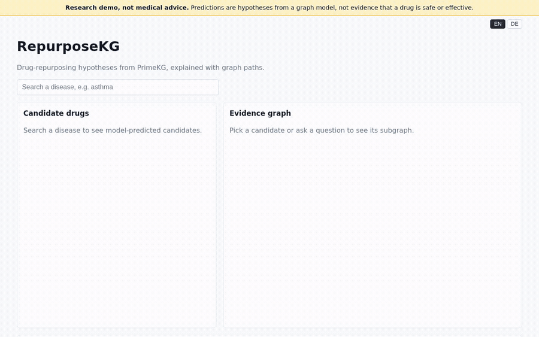
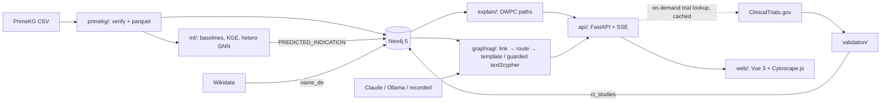

# RepurposeKG

**Drug-repurposing hypotheses from a biomedical knowledge graph.** PrimeKG (129k nodes, 4M relationships) is stored in Neo4j. A graph neural network predicts missing drug → disease links, and the evidence is shown as graph paths and ClinicalTrials.gov counts. An LLM answers questions about the graph with validated, read-only Cypher.

> Research demo, **not medical advice**. Uses PrimeKG, which includes DrugBank-derived content licensed CC BY-NC 4.0, so this project is **non-commercial**.



Re-record with `scripts/record_demo.sh` (full graph + live Claude on :8001).

**Try it online:** https://parimalgavali.github.io/drug-repurposing-kg/ is a static snapshot of the full-graph app on GitHub Pages, with saved answers to the example questions. Run it locally (below) for live questions and evidence graphs for any pair.

## Run it

**Demo in one command** (bundled 498-node fixture graph, no download; Q&A needs `ANTHROPIC_API_KEY`):

```bash
docker compose --profile demo up --build    # UI http://localhost:8080 · API http://localhost:8000/docs
```

**Full graph** (PrimeKG download ~1 GB, then models and predictions):

```bash
uv sync --extra data --extra graph --extra ml --extra llm --extra api
make data                 # PrimeKG → data/processed/*.parquet
make kg NEO4J_ADMIN="sudo -u neo4j neo4j-admin"   # see docs/GRAPH.md
make ml-baselines ml-gnn  # models, model card, PREDICTED_INDICATION
make validate             # CT.gov trial check (~1 h, cached)
make api                  # API on :8000
(cd web && npm ci && npm run dev)   # UI on :5173
make lint test
```

## Architecture



## Results

Ranking the held-out true drug for a disease (filtered MRR, 3 seeds; full table in the [model card](ml/model_card.md)):

| Model | Unseen diseases | Diseases with some known drugs |
| --- | ---: | ---: |
| popularity | 0.110 | 0.131 |
| similar-disease (shared genes/phenotypes) | **0.384** | 0.365 |
| RotatE (KGE, undertrained on CPU) | 0.015 | 0.032 |
| hetero GNN + text features | 0.146 | 0.479 |
| hetero GNN, no text | 0.083 | **0.512** |
| GNN + similar-disease blend (α on validation) | 0.374 | 0.493 |

Top-20 new candidates for 30 unseen diseases, checked against ClinicalTrials.gov: 15.3% of GNN pairs have ≥ 1 registered study vs 14.8% similar-disease, 13.2% popularity and 0.5% random. Real signal, but the GNN does not beat the simple baseline on unseen diseases.

Hetionet cross-check (treatments Hetionet records but PrimeKG lacks, top 20): similar-disease finds 73, the served GNN 57, popularity 33, random 1. Blending the GNN with the similar-disease baseline ties the baseline on unseen diseases (MRR 0.374 vs 0.384) and adds ~3 points of Hits@50, so the gap stays open ([model card](ml/model_card.md#gnn--similar-disease-blend-unseen-diseases)).

GraphRAG: 40/40 hand-written questions answered correctly (an easy benchmark, see [graphrag/eval](graphrag/eval/README.md)); write attempts never reach the database (guard + read-only transactions).

## What this project shows

- Built a biomedical knowledge graph (129k nodes, 4M edges) in Neo4j from PrimeKG with verified counts and checksums, and a read-only query client.
- Trained and honestly evaluated drug-repurposing models (baselines, PyKEEN KGE, heterogeneous PyTorch Geometric GNN) on leakage-aware splits; wrote 854k predictions back to the graph.
- Explained predictions with degree-weighted metapaths, measured how faithful those paths are to the GNN with GNNExplainer, and cross-checked predictions against ClinicalTrials.gov and Hetionet with confidence intervals.
- Built GraphRAG with entity linking, intent routing, parameterised Cypher templates and guarded text-to-Cypher, with recorded-LLM tests so CI runs offline.
- Shipped a FastAPI + SSE backend and a Vue 3 / Cytoscape.js UI with a Playwright smoke test in CI and a one-command Docker demo. Clicking a candidate looks up its ClinicalTrials.gov studies on demand (cached) and shows a linked trial badge.
- Localised to German: Wikidata German names for 2,788 drugs and 3,066 diseases, a DE/EN toggle, German answers with citations, and search by German name ("Skorbut" → scurvy) through a second full-text index.
- Exported disease subgraphs to RDF with standard ontology IRIs (MONDO, HPO, DrugBank, NCBI Gene), validated them with SHACL and served read-only SPARQL from Oxigraph, with Cypher and SPARQL compared side by side.

## Docs

- [Planning & investigation](docs/planning/2026-10-28-direction.md): goal, user loop, verified data facts, risks
- [Decisions](docs/DECISIONS.md): ADRs
- [Data](docs/DATA.md): PrimeKG and ClinicalTrials.gov, licenses, counts, checksums
- [Architecture](docs/ARCHITECTURE.md): components, graph model, GraphRAG flow, evaluation
- [Graph](docs/GRAPH.md): Neo4j labels/relationship counts, build steps, example queries
- [API](docs/API.md): endpoints, `/ask` event stream, curl walkthrough
- [Frontend](web/README.md): dev server, generated API types, tests
- German UI, answers and search: a DE/EN toggle, with Wikidata German names for drugs and diseases ([DATA](docs/DATA.md), [API](docs/API.md))
- [Semantic web](docs/SEMANTIC_WEB.md): RDF export, IRIs, SHACL shapes, `/api/sparql`, Cypher vs SPARQL
- [Roadmap](docs/ROADMAP.md) and [task specs](docs/specs/)

## Stack

Python 3.12 (uv) · Neo4j 5 · PyTorch Geometric · PyKEEN · FastAPI · Anthropic Claude / Ollama · Vue 3 + TypeScript + Cytoscape.js · Playwright

## License

Code: MIT (see `LICENSE`). Data is not redistributed; see [docs/DATA.md](docs/DATA.md) for the terms of each source.
