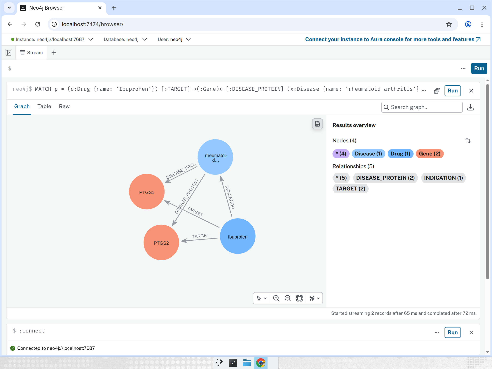

# Graph in Neo4j

Full PrimeKG as imported by `make kg` (Neo4j 5.26 Community). Every node has `id` (PrimeKG `node_index`, integer, unique per label), `source_id` (e.g. DrugBank ID, NCBI gene ID, MONDO ID), `source` and `name`. Each undirected PrimeKG edge is stored once, in the direction listed below; Cypher can match it either way with `-[]-`.



## Build

```bash
make data                                              # fetch + prepare (task 1)
sudo systemctl stop neo4j                              # bulk import is offline
make kg-import NEO4J_ADMIN="sudo -u neo4j neo4j-admin" # ~7 s on the dev VM
sudo systemctl start neo4j && make kg-schema           # constraints + indexes
```

Docker instead of the Debian package: `docker compose run --rm neo4j neo4j-admin ...` via `make kg-import NEO4J_ADMIN="docker compose run --rm neo4j neo4j-admin" IMPORT_PREFIX=/import`, then `docker compose up -d neo4j && make kg-schema`.
Without the full download: start an empty database and `make kg-fixture` loads the 498-node test graph.

Debian package install (used on the dev VM because Docker Hub rate-limits anonymous pulls): add `deb [signed-by=/usr/share/keyrings/neo4j.gpg] https://debian.neo4j.com stable 5` (the `latest` component is the 2026.x calendar line), `apt-get install neo4j=1:5.26.32`, set heap/pagecache to 4g in `/etc/neo4j/neo4j.conf`, copy `labs/apoc-*-core.jar` to `plugins/`, `neo4j-admin dbms set-initial-password` before first start.

## Labels

| Label | Nodes |
| --- | ---: |
| `BiologicalProcess` | 28,642 |
| `Gene` | 27,671 |
| `Disease` | 17,080 |
| `Phenotype` | 15,311 |
| `Anatomy` | 14,035 |
| `MolecularFunction` | 11,169 |
| `Drug` | 7,957 |
| `CellularComponent` | 4,176 |
| `Pathway` | 2,516 |
| `Exposure` | 818 |
| **total** | **129,375** |

## Relationship types

| Type | From → to | Relationships |
| --- | --- | ---: |
| `ANATOMY_PROTEIN_PRESENT` | Gene → Anatomy | 1,518,203 |
| `DRUG_DRUG` | Drug → Drug | 1,336,314 |
| `PROTEIN_PROTEIN` | Gene → Gene | 321,075 |
| `DISEASE_PHENOTYPE_POSITIVE` | Disease → Phenotype | 150,317 |
| `BIOPROCESS_PROTEIN` | Gene → BiologicalProcess | 144,805 |
| `CELLCOMP_PROTEIN` | Gene → CellularComponent | 83,402 |
| `DISEASE_PROTEIN` | Disease → Gene | 80,411 |
| `MOLFUNC_PROTEIN` | Gene → MolecularFunction | 69,530 |
| `DRUG_EFFECT` | Drug → Phenotype | 64,784 |
| `BIOPROCESS_BIOPROCESS` | BiologicalProcess → BiologicalProcess | 52,886 |
| `PATHWAY_PROTEIN` | Gene → Pathway | 42,646 |
| `DISEASE_DISEASE` | Disease → Disease | 32,194 |
| `CONTRAINDICATION` | Drug → Disease | 30,675 |
| `ANATOMY_PROTEIN_ABSENT` | Gene → Anatomy | 19,887 |
| `PHENOTYPE_PHENOTYPE` | Phenotype → Phenotype | 18,736 |
| `TARGET` | Drug → Gene | 16,380 |
| `ANATOMY_ANATOMY` | Anatomy → Anatomy | 14,032 |
| `MOLFUNC_MOLFUNC` | MolecularFunction → MolecularFunction | 13,574 |
| `INDICATION` | Drug → Disease | 9,388 |
| `ENZYME` | Drug → Gene | 5,317 |
| `CELLCOMP_CELLCOMP` | CellularComponent → CellularComponent | 4,845 |
| `PHENOTYPE_PROTEIN` | Gene → Phenotype | 3,330 |
| `TRANSPORTER` | Drug → Gene | 3,092 |
| `OFF_LABEL_USE` | Drug → Disease | 2,568 |
| `PATHWAY_PATHWAY` | Pathway → Pathway | 2,535 |
| `EXPOSURE_DISEASE` | Disease → Exposure | 2,304 |
| `EXPOSURE_EXPOSURE` | Exposure → Exposure | 2,070 |
| `EXPOSURE_BIOPROCESS` | Exposure → BiologicalProcess | 1,625 |
| `EXPOSURE_PROTEIN` | Gene → Exposure | 1,212 |
| `DISEASE_PHENOTYPE_NEGATIVE` | Disease → Phenotype | 1,193 |
| `CARRIER` | Drug → Gene | 864 |
| `EXPOSURE_MOLFUNC` | Exposure → MolecularFunction | 45 |
| `EXPOSURE_CELLCOMP` | Exposure → CellularComponent | 10 |
| **total** | | **4,050,249** |

## Schema (`kg/schema.cypher`)

- Uniqueness constraint on `id` for each of the 10 labels.
- Range indexes on `Drug.name`, `Disease.name`.
- Full-text index `entityNames` over `name` on all labels: `CALL db.index.fulltext.queryNodes('entityNames', 'parkinson*')`.

## Example queries (`kg/queries/`)

Each `.cypher` file has `// name:`, `// description:` and `// params:` header lines and is loaded by `kg.queries.load_queries()`. All run read-only through `KGClient.read`. Timings on the full graph, warm cache:

| Query | Example params | Rows | Time |
| --- | --- | ---: | ---: |
| `drugs_indicated_for_disease` | `{"disease": "asthma"}` | 40 | 8 ms |
| `contraindicated_drugs` | `{"disease": "asthma"}` | 128 | 6 ms |
| `drug_protein_interactions` | `{"drug": "Ibuprofen"}` | 27 | 4 ms |
| `shared_targets` | `{"drug_a": "Epinephrine", "drug_b": "Norepinephrine"}` | 7 | 4 ms |
| `mechanism_paths` | `{"drug": "Ibuprofen", "disease": "rheumatoid arthritis"}` | 17 | 6 ms |
| `disease_genes` | `{"disease": "Parkinson disease"}` | 104 | 6 ms |
| `similar_diseases_by_phenotype` | `{"disease": "Parkinson disease"}` | 10 | 15 ms |
| `drug_side_effects` | `{"drug": "Prednisone"}` | 50 | 13 ms |
| `target_based_candidates` | `{"disease": "rheumatoid arthritis"}` | 20 | 8 ms |
| `entity_search` | `{"q": "parkinson*"}` | 10 | 4 ms |

`tests/integration/` runs all ten against `NEO4J_URI` (loading the fixture into an empty database first) and asserts each returns rows in < 2 s; CI runs them against a `neo4j:5.26-community` service container.
